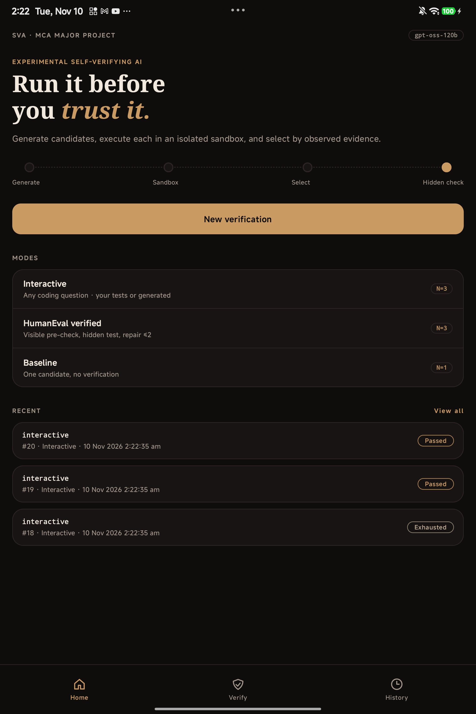
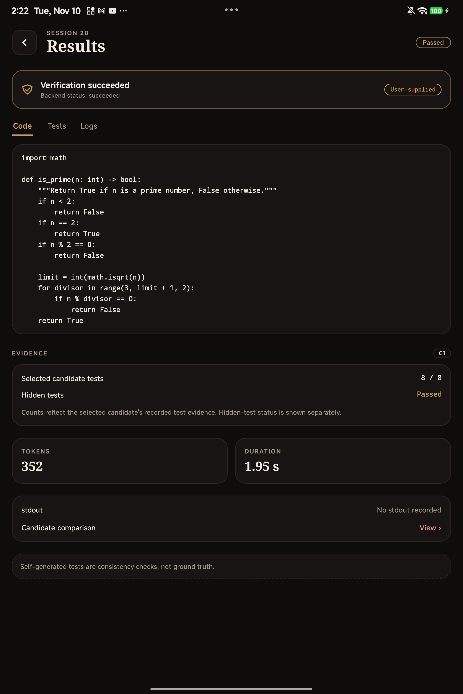
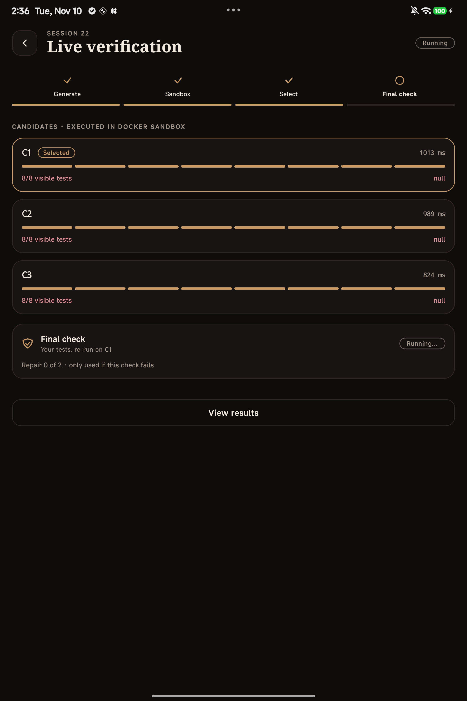
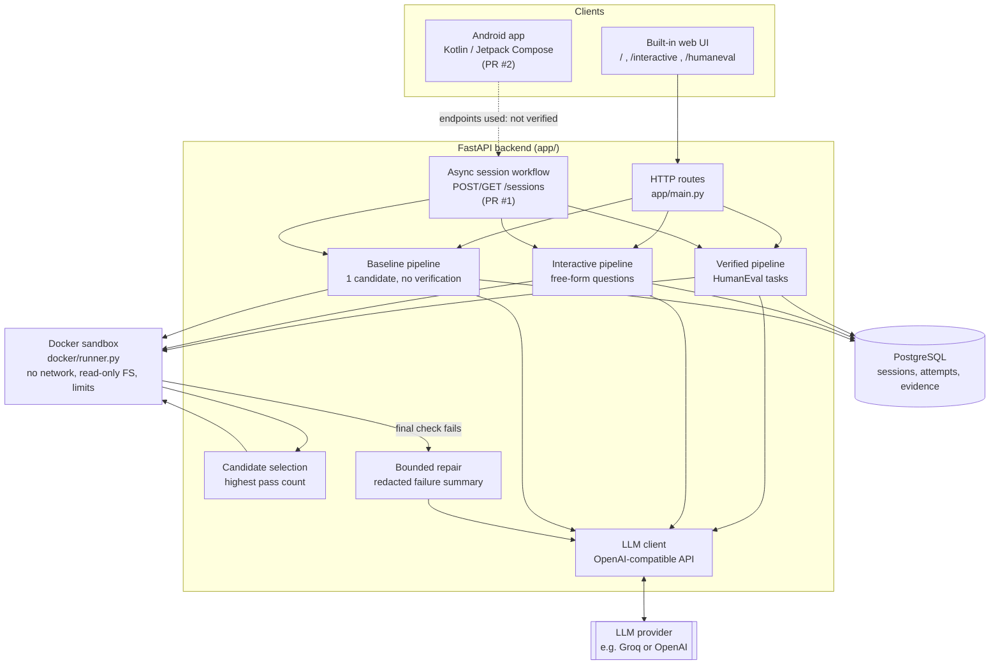

# Experimental Self-Verifying AI (SVA)

**Run it before you trust it.**

SVA is an MCA major-project research prototype that explores an evidence-driven AI coding workflow. Instead of accepting a single LLM-generated answer, it generates several candidate solutions, executes each one in an isolated Docker sandbox, compares what actually happened, selects a candidate, and runs a final check before accepting it. If the final check fails, a bounded repair step is attempted.

The goal is to make AI-generated solutions more reliable and more traceable through observed execution evidence rather than model self-assessment.

> **Important:** passing tests is evidence, not proof. Tests you supply are only as good as the cases you wrote. Tests the model generates for itself are consistency checks, not ground truth. See [How verification is labelled](#how-verification-is-labelled).

## Table of Contents

- [Overview and status](#overview-and-status)
- [Screenshots](#screenshots)
- [How SVA works](#how-sva-works)
- [How verification is labelled](#how-verification-is-labelled)
- [Architecture](#architecture)
- [Verification modes](#verification-modes)
- [Technology stack](#technology-stack)
- [Repository structure](#repository-structure)
- [Backend setup (Windows PowerShell)](#backend-setup-windows-powershell)
- [Android setup (Windows PowerShell)](#android-setup-windows-powershell)
- [API overview](#api-overview)
- [Example workflow](#example-workflow)
- [Testing](#testing)
- [Evaluation (author-reported)](#evaluation-author-reported)
- [Limitations](#limitations)
- [Future improvements](#future-improvements)
- [Contributors](#contributors)
- [References](#references)

## Overview and status

| Component | Status |
|---|---|
| FastAPI backend: baseline, verified (HumanEval) and interactive pipelines | Implemented on `main` |
| Docker sandbox executor with network, filesystem and resource restrictions | Implemented on `main` |
| PostgreSQL persistence of sessions and attempts (Alembic migrations 0001–0004) | Implemented on `main` |
| Built-in web UI (`/`, `/interactive`, `/humaneval`) | Implemented on `main` |
| Evaluation scripts (`scripts/run_evaluation.py`, `scripts/compute_metrics.py`) | Implemented on `main` |
| Async session workflow: `POST /sessions`, `GET /sessions`, `GET /sessions/{id}`, stage tracking, bounded worker pool | In open pull request [#1](https://github.com/Harsh0012-ux/Self-Verifying-AI/pull/1); not merged |
| Android client (Kotlin / Jetpack Compose, `android/`) | In open pull request [#2](https://github.com/Harsh0012-ux/Self-Verifying-AI/pull/2); not merged |
| Confidence-weighted candidate selection | Planned (selection currently uses raw visible-test pass count) |
| Competing-hypothesis failure diagnosis | Planned (repair is currently a single feedback-and-retry step) |
| Domains other than code generation | Planned |

## Screenshots

The three screenshot files referenced below are not present in this checkout yet. Add the actual JPG captures at these paths to display them; no screenshots have been generated or substituted.

<table>
  <tr>
    <td align="center" width="33%">
      <br>
      <sub><b>Home</b>: the Generate, Sandbox, Select and Hidden check stages, the three verification modes (Interactive, HumanEval verified, Baseline) and recent sessions with their outcomes.</sub>
    </td>
    <td align="center" width="33%">
      <br>
      <sub><b>Results</b>: a completed session (Passed) labelled "User-supplied", showing the selected code, 8/8 selected-candidate tests, hidden-test status, tokens and duration.</sub>
    </td>
    <td align="center" width="33%">
      <br>
      <sub><b>Evidence</b>: the selected candidate's code and its evidence summary from a completed session (8/8 selected-candidate tests, hidden tests Passed). This view does not list the individual tests.</sub>
    </td>
  </tr>
</table>

## How SVA works

1. **Submit.** The user submits a coding question, optionally with their own test assertions (interactive mode), or picks a HumanEval task.
2. **Generate.** The backend asks the LLM for several candidate solutions (default 3, set by `VERIFICATION_CANDIDATES`).
3. **Execute.** Each candidate runs in its own Docker sandbox against the available tests.
4. **Collect evidence.** Per-test pass/fail, stdout, stderr, timing and token usage are recorded.
5. **Select.** The candidate with the highest observed test pass count is selected. Ties go to the first-generated candidate.
6. **Final check.** The selected candidate is executed once more against the final oracle (see the table below for what that means in each mode).
7. **Repair (only if the final check fails).** The model is asked for a corrected version, up to `MAX_REPAIR_ATTEMPTS` times (default 2). The repair prompt contains only a redacted summary of the failure (failure count, built-in exception type names, timeout or exit status), never raw test source, stdout or stderr.
8. **Record.** Sessions, candidates, repair attempts and their evidence are persisted to PostgreSQL.

If the budget is exhausted without a passing result, the session ends as `exhausted`.

## How verification is labelled

| Term | Meaning in SVA |
|---|---|
| **User-supplied tests** | Assertions the user provides. The strongest evidence available in interactive mode, but only as complete as the user's cases. |
| **Self-generated consistency tests** | Assertions proposed by the LLM for each candidate and pooled across candidates. They check candidates against each other. They are **not** ground truth, and the session is labelled `self_generated`. |
| **Visible pre-check** | In HumanEval mode, assertions derived from the examples in the task's docstring. Cheap, used to rank candidates. |
| **Hidden / final check** | In HumanEval mode, the benchmark's canonical test, which the model never sees. In interactive mode there is no separate hidden test: the same oracle (your tests, or the pooled self-generated tests) is run again on the selected candidate, so it is a re-run, not an independent second opinion. |
| **Candidate selection** | Choosing among generated candidates using their pre-final-check pass count. |
| **Final verification** | The final check on the selected candidate, followed by the bounded repair step on failure. |

The Android app labels the last stage "Hidden check" on the home screen and "Final check" on the live verification screen; both refer to the final check above.

## Architecture



| Component | Role |
|---|---|
| **Android app** | Mobile client showing modes, stage progress, results and history. Source is in open PR #2. Which backend endpoints it calls has not been verified for this README. |
| **Built-in web UI** | Three server-rendered pages in `app/main.py` using vanilla HTML/CSS/JS. |
| **FastAPI backend** | Routes requests to the three pipelines and exposes JSON endpoints. |
| **Pipelines** | Baseline (`app/pipeline.py`), verified (`app/verified_pipeline.py`), interactive (`app/interactive_pipeline.py`). Interactive reuses selection and repair-redaction logic from the verified pipeline. |
| **LLM client** | `app/llm.py` wraps the OpenAI Python SDK and accepts a custom `base_url`, so any OpenAI-compatible provider works. |
| **Docker sandbox** | `app/sandbox.py` launches `docker/runner.py` in a container with no network, read-only filesystem, non-root user, dropped capabilities, and process, memory, CPU and time limits. |
| **Candidate selection** | Picks the highest pass count; no confidence weighting is implemented. |
| **Repair** | Single feedback-and-retry loop with an allow-listed failure summary. |
| **PostgreSQL** | Stores sessions and every candidate and repair attempt with its evidence. Schema managed by Alembic. |

Components labelled PR #1 and PR #2 are not on `main` yet.

## Verification modes

| Mode | Candidates | What it does |
|---|---|---|
| **Interactive** | 3 | Any coding question. Uses your tests if provided, otherwise pooled self-generated consistency tests (labelled as weaker evidence). |
| **HumanEval verified** | 3 | Visible pre-check on docstring examples, then the hidden benchmark test, with up to 2 repair attempts. |
| **Baseline** | 1 | One candidate, no verification. Kept deliberately unverified as the comparison point for evaluation. |

## Technology stack

| Layer | Technology |
|---|---|
| Backend language | Python 3.11 or newer (`requires-python = ">=3.11"` in [`pyproject.toml`](pyproject.toml)) |
| API | [FastAPI](https://fastapi.tiangolo.com/) (>=0.115) with Uvicorn |
| LLM access | OpenAI Python SDK (`openai>=1.0`) against an OpenAI-compatible endpoint; the project has been run against Groq with `openai/gpt-oss-120b` |
| Sandbox | [Docker](https://docs.docker.com/) via the `docker` Python SDK (>=7.1), `python:3.11-alpine` based image |
| Persistence | PostgreSQL, SQLAlchemy (>=2.0), `psycopg` 3, [Alembic](https://alembic.sqlalchemy.org/) |
| Configuration | `pydantic-settings`, values read from `.env` |
| Web UI | Server-rendered HTML with vanilla CSS/JS, no build step |
| Backend tests | [pytest](https://docs.pytest.org/) and pytest-cov (dev extras) |
| Benchmark | [HumanEval](https://github.com/openai/human-eval) |
| Android client | [Kotlin](https://kotlinlang.org/docs/) and [Jetpack Compose](https://developer.android.com/develop/ui/compose); minSdk 26, compileSdk 37, targetSdk 37, Java 11 compatibility, Gradle wrapper 9.8.2 |

Kotlin, Compose and Android Gradle Plugin library versions have not been verified for this README.

## Repository structure

```text
.
├── app/            # FastAPI app, pipelines, sandbox executor, LLM client, models
├── docker/         # sandbox.Dockerfile and runner.py (runs inside the container)
├── alembic/        # database migrations
├── scripts/        # evaluation, metrics and diagnostic scripts
├── tests/          # pytest suite
├── docs/           # PROJECT_HANDOFF.md, screenshots
├── android/        # Android client (added by open PR #2)
├── .env.example
├── alembic.ini
└── pyproject.toml
```

- Backend source: [`app/`](https://github.com/Harsh0012-ux/Self-Verifying-AI/tree/main/app)
- Sandbox: [`docker/`](https://github.com/Harsh0012-ux/Self-Verifying-AI/tree/main/docker)
- Migrations: [`alembic/`](https://github.com/Harsh0012-ux/Self-Verifying-AI/tree/main/alembic)
- Scripts: [`scripts/`](https://github.com/Harsh0012-ux/Self-Verifying-AI/tree/main/scripts)
- Tests: [`tests/`](https://github.com/Harsh0012-ux/Self-Verifying-AI/tree/main/tests)
- Detailed technical handoff: [`docs/PROJECT_HANDOFF.md`](docs/PROJECT_HANDOFF.md)
- Android source: `android/` (exists once PR #2 is merged)

`evaluation_results/` is generated by the evaluation scripts and is gitignored.

## Backend setup (Windows PowerShell)

**Prerequisites:** [Docker Desktop](https://docs.docker.com/desktop/) (running), Python 3.11 or newer, Git, and an API key for an OpenAI-compatible LLM provider.

```powershell
# 1. Clone
git clone https://github.com/Harsh0012-ux/Self-Verifying-AI.git
cd Self-Verifying-AI

# 2. Virtual environment
python -m venv .venv
.\.venv\Scripts\Activate.ps1

# 3. Install with dev dependencies
pip install -e ".[dev]"

# 4. Start PostgreSQL (the database name must match DATABASE_URL)
docker run --name sva-postgres -e POSTGRES_PASSWORD=<password> -e POSTGRES_DB=sva -p 5432:5432 -d postgres:16

# 5. Build the sandbox image
docker build -t sva-sandbox:latest -f docker/sandbox.Dockerfile .

# 6. Configure environment, then edit .env
Copy-Item .env.example .env

# 7. Apply migrations
alembic upgrade head

# 8. Run the server
uvicorn app.main:app --reload
```

The app is then at `http://127.0.0.1:8000/` and the FastAPI-generated Swagger UI at `http://127.0.0.1:8000/docs`. Replace `<password>` with your own choice and use the same value in `DATABASE_URL`.

### Environment variables

Set these in `.env` (copied from [`.env.example`](.env.example)). Never commit `.env` or paste API keys into issues, chats or commits.

| Variable | Required | Description |
|---|---|---|
| `LLM_API_KEY` | Yes | API key for your LLM provider |
| `LLM_MODEL` | Yes | Model identifier, for example `openai/gpt-oss-120b` |
| `LLM_BASE_URL` | No | Custom OpenAI-compatible endpoint (omit for OpenAI itself) |
| `DATABASE_URL` | Yes | PostgreSQL connection string |
| `HUMANEVAL_CACHE_PATH` | No | Local cache path for the dataset (default `.cache/humaneval.jsonl`) |
| `VERIFICATION_CANDIDATES` | No | Candidates per verified session (default 3) |
| `MAX_REPAIR_ATTEMPTS` | No | Maximum repair retries (default 2) |

**Troubleshooting.** If the app or Alembic connects to the wrong database or uses the wrong key, check for stale `DATABASE_URL` or `LLM_API_KEY` values set at the OS level in an already-open terminal, and open a fresh one. A 503 mentioning the sandbox image means step 5 needs to be run.

## Android setup (Windows PowerShell)

The Android client lives in `android/` (Android Studio project name `NewSelfVerifyingApp`) and is added by open PR #2.

| Setting | Value |
|---|---|
| Language / UI | Kotlin, Jetpack Compose |
| minSdk / compileSdk / targetSdk | 26 / 37 / 37 |
| Java compatibility | 11 |
| Gradle wrapper | 9.8.2 |

**Prerequisites:** [Android Studio](https://developer.android.com/studio) with the Android SDK for API 37, a JDK that Gradle 9.8.2 supports, an emulator or physical device (API 26 or newer), and the [backend](#backend-setup-windows-powershell) running.

Build a debug APK (this command completed successfully for the project author):

```powershell
cd android
.\gradlew.bat assembleDebug
```

To run it, open `android/` in Android Studio, let Gradle sync, and run the app on an emulator or device.

**Pointing the app at your backend (unverified).** Where the backend URL is configured in the Android source, and which API endpoints the app calls, have not been verified for this README. Check the Android source in PR #2 before relying on either. General Android networking notes that apply regardless:

- An emulator reaches the host PC at `http://10.0.2.2:<port>`.
- A physical device needs the backend started with `uvicorn app.main:app --host 0.0.0.0` and your PC's LAN address, on the same network.
- Android blocks cleartext `http://` traffic by default on recent versions, so a plain-HTTP backend needs a network security configuration in the app.

Documentation: [Android developers](https://developer.android.com/), [Kotlin](https://kotlinlang.org/docs/), [Jetpack Compose](https://developer.android.com/develop/ui/compose).

## API overview

Implemented on `main`. Interactive documentation is served at `/docs` when the app is running.

| Method | Path | Description |
|---|---|---|
| `GET` | `/` | Home page |
| `GET` | `/interactive` | Interactive Verification Studio |
| `GET` | `/humaneval` | HumanEval demo page |
| `GET` | `/tasks/humaneval` | List cached HumanEval task ids |
| `POST` | `/baseline/run` | Run the baseline pipeline on a HumanEval task |
| `POST` | `/verified/run` | Run the verified pipeline on a HumanEval task |
| `POST` | `/interactive/run` | Run the verified pipeline on a free-form question (`question`, optional `code`, optional `tests`) |

In open PR #1 (not on `main`): `POST /sessions` (returns 202), `GET /sessions`, `GET /sessions/{id}`, for asynchronous sessions with stage tracking. Request and response schemas for these have not been verified for this README.

## Example workflow

```powershell
$body = @{
  question = "Write a function that reverses a string."
  tests    = @('assert reverse_string("abc") == "cba"')
} | ConvertTo-Json

Invoke-RestMethod -Method Post -Uri http://127.0.0.1:8000/interactive/run `
  -ContentType "application/json" -Body $body
```

The response contains the session (status `succeeded` or `exhausted`, `oracle_kind` of `user_supplied` or `self_generated`) and every candidate and repair attempt with its evidence. Omit `tests` to let SVA pool self-generated consistency tests; the session is then labelled as weaker evidence.

The Results screenshot above shows a completed session whose selected code is an `is_prime` function, labelled "User-supplied", with 8/8 selected-candidate tests and the hidden-test status Passed.

## Testing

```powershell
# Fast tests, no external services
python -m pytest -m "not integration"

# Full suite (needs Docker, the sva-sandbox image, PostgreSQL and an LLM key)
python -m pytest
```

Tests cover dataset loading, sandbox behaviour (including infinite-loop and subprocess-spawn candidates), the three pipelines, repair bounds and metric calculations. Tests marked `integration` require a local Docker daemon and the `sva-sandbox` image.

## Evaluation (author-reported)

These figures are **author-reported** and were not independently reproduced for this README.

| Metric | Baseline | Verified |
|---|---|---|
| Task success rate | 92% (69/75) | 100% (75/75) |
| Average tokens per trial | 476 | 1,444 (about 3.0×) |
| Average duration per trial | 617 ms | 1,753 ms (about 2.8×) |

Setup: 25 HumanEval tasks × 3 trials × 2 pipelines (150 runs), one model (`openai/gpt-oss-120b` via Groq).

How to read them:

- The 25-task cap is a loader default (`HumanEvalLoader(limit=25)`), not a property of HumanEval, which has 164 tasks.
- The sample is small and no significance testing or confidence intervals were applied, so the 92% to 100% change is indicative only.
- The improvement comes from candidate generation and selection. The repair loop never triggered in these runs, so recovery is implemented and unit-tested but **not** empirically validated.
- Only one model and one domain were tested.
- Raw results are gitignored, so these numbers cannot be reproduced from the repository alone. Re-run `python scripts/run_evaluation.py` then `python scripts/compute_metrics.py` before citing them.

## Limitations

- Evaluated only on HumanEval-style code generation, with a small sample, one model, and no statistical significance testing.
- Passing user-supplied tests shows a candidate satisfies those cases, not that it is correct. Self-generated tests only check consistency.
- In interactive mode the final check re-runs the same tests; it is not independent.
- Selection uses raw pass count; ties go to the first-generated candidate.
- Repair is a single feedback-and-retry step and has not been exercised by real evaluation failures.
- The Docker sandbox is configured with network disabled, read-only filesystem, non-root user and resource limits, and tested against hostile candidates, but it has not been security-audited and the Docker daemon is assumed trusted.
- Prompts, including free-form questions and code, are sent to a third-party LLM provider in plain text.
- No authentication or rate limiting: do not expose the API publicly.
- The web UI has no automated tests.
- The Android client, the async session endpoints, and the details listed as unverified above are not yet on `main`.

## Future improvements

- Evaluate on the full HumanEval set and on tasks chosen to exercise the repair path.
- Confidence-weighted candidate selection.
- Competing-hypothesis failure diagnosis.
- Cross-model and cross-domain evaluation, with confidence intervals.
- Authentication, rate limiting and CI for the backend.

## Contributors

- Harsh ([@Harsh0012-ux](https://github.com/Harsh0012-ux)): sole developer. MCA (AI & DS) major project, K.R. Mangalam University.

## References

- [HumanEval benchmark](https://github.com/openai/human-eval) (Chen et al., 2021)
- [Docker documentation](https://docs.docker.com/)
- [Android developer documentation](https://developer.android.com/)
- [Kotlin documentation](https://kotlinlang.org/docs/)
- [Jetpack Compose documentation](https://developer.android.com/develop/ui/compose)
- [FastAPI](https://fastapi.tiangolo.com/), [SQLAlchemy](https://docs.sqlalchemy.org/), [Alembic](https://alembic.sqlalchemy.org/), [pytest](https://docs.pytest.org/)
