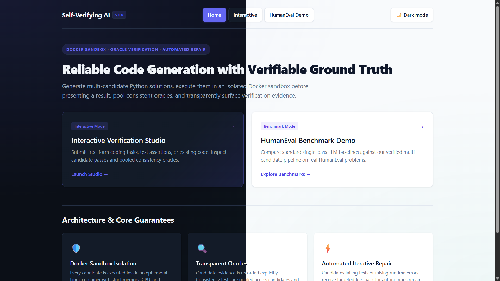
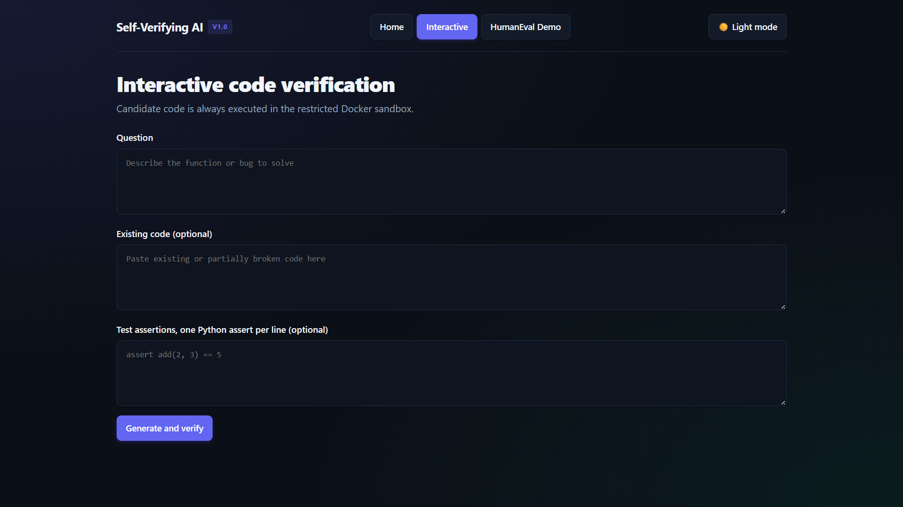
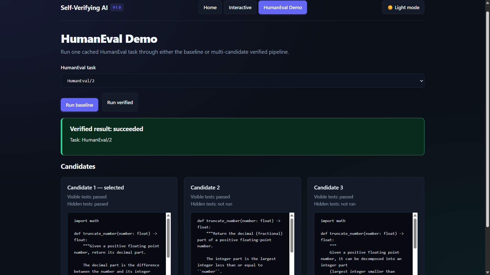
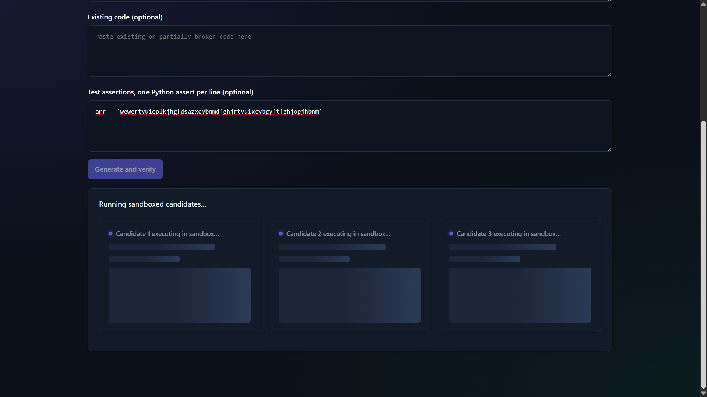
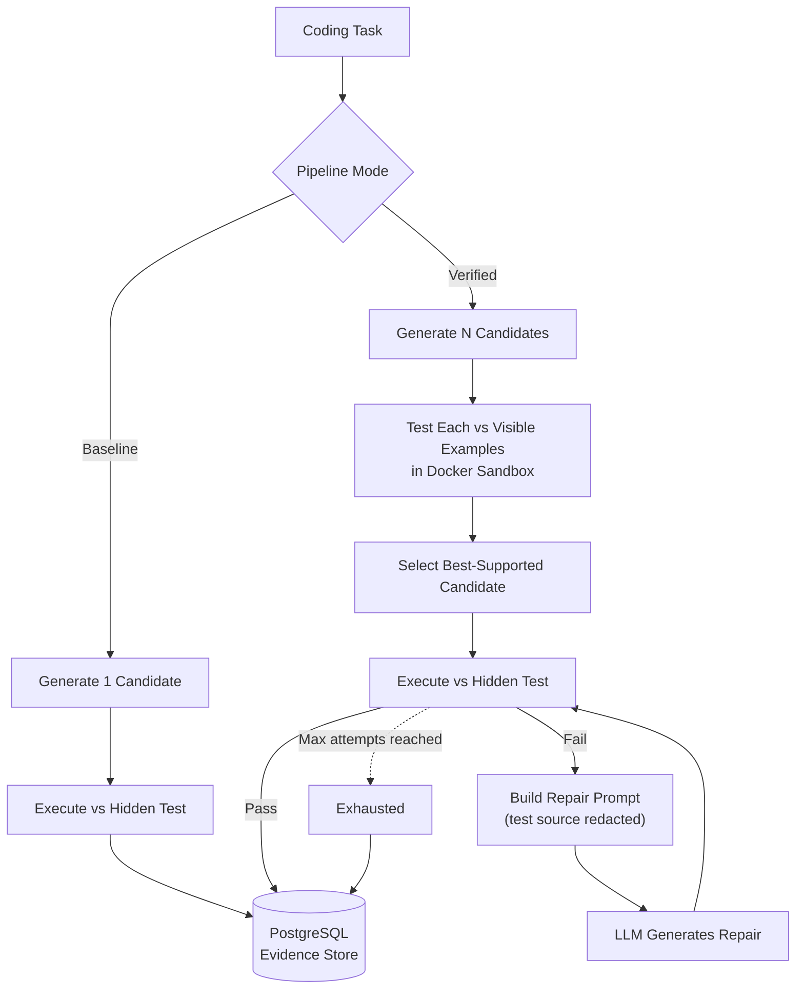
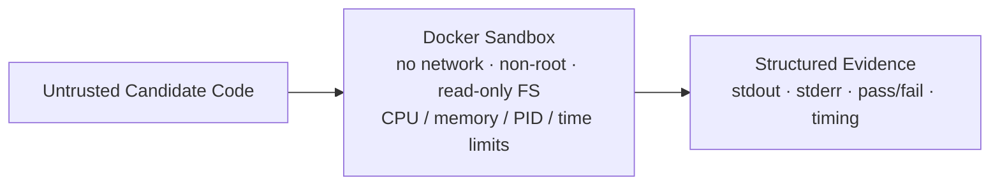

# Experimental Self-Verifying AI

**Can an AI agent test its own work before trusting it — and repair itself when it's wrong?**

An MCA research prototype that inserts an experimental verification layer between AI decision generation and execution. Instead of trusting a single LLM-generated answer, the system generates multiple candidates, tests them in an isolated sandbox, selects the best-supported one using real evidence, and — if it still fails — diagnoses and repairs it, all within a bounded budget.

Evaluated against a direct, unverified baseline on the HumanEval code-generation benchmark:

| Metric | Baseline | Verified |
|---|---|---|
| Task Success Rate | 92% | **100%** |
| Verification Accuracy | — | **99.56%** |
| False Positive Rate | — | 0.51% |
| False Negative Rate | — | 0% |
| Avg. Tokens / Trial | 476 | 1,444 |
| Avg. Duration / Trial | 617 ms | 1,753 ms |

*Full methodology and discussion in [Results](#results).*

---

## Table of Contents

- [Why This Exists](#why-this-exists)
- [Screenshots](#screenshots)
- [Architecture](#architecture)
- [Features](#features)
- [Tech Stack](#tech-stack)
- [Project Structure](#project-structure)
- [Getting Started](#getting-started)
- [API Reference](#api-reference)
- [Running the Evaluation](#running-the-evaluation)
- [Results](#results)
- [Testing](#testing)
- [Security & Integrity](#security--integrity)
- [Limitations](#limitations)
- [Future Work](#future-work)
- [Acknowledgments](#acknowledgments)

---

## Why This Exists

Current LLM-based agents generate a decision and execute it directly — there's no checkpoint between "the model thinks this is right" and it actually running. Prior approaches to improving reliability (**ReAct**, **Self-Refine**, **Reflexion**, **Chain-of-Verification**) all improve an answer through the model reconsidering it *in text* — reflecting, critiquing, asking itself questions — without ever executing a candidate to see what actually happens.

This project's claim: verification should be **experimental**, not textual. Generate multiple candidates, run them, and let observed evidence — not the model's self-assessment — decide what gets trusted.

## Screenshots

> Capture these pages (light and dark mode) from your running instance and save them into `docs/screenshots/` using the filenames below — they'll render automatically once added.

| Page | Screenshot |
|---|---|
| Home |  |
| Interactive Verification Studio |  |
| HumanEval Benchmark Demo |  |
| Candidate loading state |  |

## Architecture

Two loops around a real execution step: verify *before* committing, diagnose and repair *after* a failure.



Every execution — candidate or repair — runs through the same hardened sandbox:



## Features

**Baseline Pipeline** — `POST /baseline/run`
One LLM-generated candidate, executed directly against the hidden test. The unverified comparison point.

**Verified Pipeline** — `POST /verified/run`
Generates 3 candidates, tests each against visible examples, selects the strongest, executes it against the hidden test, and runs a bounded repair loop on failure. Full attempt history persisted.

**Interactive Verification Studio** — `GET /interactive`
Free-form coding questions, not just HumanEval tasks. Supply your own test assertions for real verification ("Verified against your tests"), or let the system pool self-generated consistency checks across candidates ("Self-verified, no independent ground truth" — honestly labeled as weaker evidence). Automatically detects a canonical function name across candidates so pooled tests don't fail each other for trivial naming mismatches. Always surfaces a best-effort final answer, copy-to-clipboard included, even when full verification fails.

**HumanEval Benchmark Demo** — `GET /humaneval`
Pick any cached HumanEval task and run it through either pipeline interactively, side by side.

**Evaluation Harness**
Resumable batch runner across the full task set with provider rate-limit pacing and retry, plus a metrics exporter computing task success rate, verification accuracy (with false positive/negative breakdown), recovery success rate, replanning efficiency, cost overhead, and safety violation rate.

**Dark Mode, Responsive Design**
Three-page app (Home / Interactive / HumanEval Demo) with a shared theme toggle persisted across navigation, defaulting to system preference, tested at desktop/tablet/mobile breakpoints.

## Tech Stack

| Layer | Technology |
|---|---|
| Language | Python 3.14 |
| API | FastAPI + Uvicorn |
| LLM Access | OpenAI SDK (OpenAI-compatible — tested against Groq) |
| Sandbox | Docker (isolated execution container) |
| Persistence | PostgreSQL + SQLAlchemy + Alembic |
| Frontend | Vanilla HTML/CSS/JS — no framework, no build step |
| Testing | pytest |
| Benchmark | [HumanEval](https://github.com/openai/human-eval) (MIT licensed) |

## Project Structure

```
.
├── app/
│   ├── main.py                  # FastAPI app: routes, pages, request handling
│   ├── config.py                # Settings loaded from .env
│   ├── llm.py                   # LLM client abstraction (OpenAI-compatible)
│   ├── dataset.py                # HumanEval loader + local cache
│   ├── code_extraction.py       # Strips markdown fences / prose from LLM output
│   ├── pipeline.py              # Baseline pipeline
│   ├── verified_pipeline.py     # Verified pipeline: generate, select, repair
│   ├── interactive_pipeline.py  # Free-form question pipeline + oracle logic
│   ├── sandbox.py               # Docker sandbox executor
│   ├── models.py                # SQLAlchemy models
│   └── database.py              # Engine + session factory
├── docker/
│   ├── sandbox.Dockerfile       # Restricted execution image
│   └── runner.py                # Runs inside the container; emits structured evidence
├── alembic/
│   └── versions/                # 0001 baseline → 0004 interactive sessions
├── scripts/
│   ├── validate_baseline.py     # 5-task baseline smoke test
│   ├── run_evaluation.py        # Full resumable evaluation batch
│   ├── compute_metrics.py       # Aggregate + per-task metric CSVs
│   └── diagnose_visible_tests.py
├── tests/                       # pytest suite (unit + integration-marked)
├── evaluation_results/          # Generated CSV output
├── pyproject.toml
├── alembic.ini
└── .env.example
```

## Getting Started

**Prerequisites:** Docker Desktop, Python 3.14+, an OpenAI-compatible LLM API key.

```powershell
# 1. Install dependencies
pip install -e ".[dev]"

# 2. Start PostgreSQL
docker run --name sva-postgres -e POSTGRES_PASSWORD=<password> -e POSTGRES_DB=sva -p 5432:5432 -d postgres:16

# 3. Build the sandbox image
docker build -t sva-sandbox:latest -f docker/sandbox.Dockerfile .

# 4. Configure environment
copy .env.example .env
# then edit .env — see table below

# 5. Apply database migrations
alembic upgrade head

# 6. Run the app
uvicorn app.main:app --reload
```

Visit `http://127.0.0.1:8000/` for the home page, or `/docs` for the auto-generated API reference.

**Environment variables (`.env`):**

| Variable | Required | Description |
|---|---|---|
| `LLM_API_KEY` | Yes | Your LLM provider's API key — never commit this |
| `LLM_MODEL` | Yes | Model identifier (e.g. `openai/gpt-oss-120b`) |
| `LLM_BASE_URL` | No | Custom OpenAI-compatible endpoint (e.g. Groq) — omit for OpenAI itself |
| `DATABASE_URL` | Yes | PostgreSQL connection string |
| `HUMANEVAL_CACHE_PATH` | No | Local path for the cached dataset (default: `.cache/humaneval.jsonl`) |
| `VERIFICATION_CANDIDATES` | No | Candidates generated per verified session (default: 3) |
| `MAX_REPAIR_ATTEMPTS` | No | Bounded repair retries (default: 2) |

The first dataset request downloads HumanEval's MIT-licensed JSONL from the upstream repository and caches it locally.

## API Reference

| Method | Path | Description |
|---|---|---|
| `GET` | `/` | Home / landing page |
| `GET` | `/interactive` | Interactive Verification Studio |
| `GET` | `/humaneval` | HumanEval Benchmark Demo |
| `GET` | `/tasks/humaneval` | List cached HumanEval task IDs |
| `POST` | `/baseline/run` | Run the baseline pipeline on a HumanEval task |
| `POST` | `/verified/run` | Run the verified pipeline on a HumanEval task |
| `POST` | `/interactive/run` | Run the verified pipeline on a free-form question |

**Example — `POST /verified/run`:**
```json
{ "task_id": "HumanEval/0" }
```
```json
{
  "session": { "id": 1, "task_id": "HumanEval/0", "status": "succeeded" },
  "attempts": [
    { "phase": "candidate", "attempt_index": 0, "is_selected": true,
      "passed_visible_tests": true, "passed_hidden_tests": true }
  ]
}
```

**Example — `POST /interactive/run`:**
```json
{
  "question": "Write a function that reverses a string.",
  "tests": ["assert reverse_string(\"abc\") == \"cba\""]
}
```

Full request/response schemas: `/docs` (Swagger UI) once the app is running.

## Running the Evaluation

```powershell
# Small dry run first
python scripts/run_evaluation.py --task-limit 3 --trials 1

# Full configured evaluation (25 tasks × 3 trials × 2 pipelines = 150 runs)
python scripts/run_evaluation.py

# Generate metrics
python scripts/compute_metrics.py
```

Output: `evaluation_results/aggregate_metrics.csv` and `per_task_metrics.csv`.

## Results

25 HumanEval tasks × 3 independent trials × 2 pipelines (150 total runs, 225 verified candidates):

- **Task success rate** improved from 92% (baseline) to **100%** (verified) — every task baseline ever failed was resolved by candidate selection alone.
- **Verification accuracy: 99.56%** across all 225 generated candidates — the cheap, pre-execution visible-test check almost never approved a candidate that later failed (0.51% false positives) and never wrongly rejected one that would have passed (0% false negatives).
- **Cost of verification:** ~3.0× the tokens, ~2.8× the duration of baseline — the measurable price of the reliability gain.
- **Zero sandbox safety violations** across all 150 runs.
- The repair/recovery mechanism was implemented and independently unit-tested but was **not triggered by real data** in this evaluation — every selected candidate passed on its first hidden-test attempt. See [Limitations](#limitations).

## Testing

```powershell
# Fast tests only
python -m pytest -m "not integration"

# Full suite (requires Docker + PostgreSQL)
python -m pytest
```

27 tests across dataset loading, sandbox security (including deliberately hostile candidates — infinite loops, subprocess escape attempts), baseline/verified/interactive pipeline logic, repair-loop bounds, and metric calculations.

## Security & Integrity

- **Sandbox isolation:** every candidate — baseline, verified, interactive, repair — runs in a Docker container with no network access, a read-only filesystem, a non-root user, dropped Linux capabilities, and CPU/memory/process/time limits. Independently tested against infinite loops and subprocess-escape attempts.
- **Repair-prompt integrity:** when a candidate fails, the repair prompt is built from an explicit allow-list (failure count, exception type, timeout/process status) — never the raw test source, stdout, or stderr. This guarantees a hidden HumanEval test (or a user-supplied oracle assertion) can never leak back to the model through its own failure message. Verified by inspecting real repair-prompt text sent during a live, deliberately-triggered repair.
- **Secrets:** API keys are read from environment variables only and are never logged, stored in the database, or committed.

## Limitations

- Evaluated on a single domain (HumanEval-style code generation); generalization to other decision domains not tested.
- Candidate selection uses raw visible-test pass count, not the confidence-weighted formula proposed in the original research design.
- The implemented repair mechanism is a single feedback-and-retry step rather than the originally envisioned generation and testing of multiple competing failure hypotheses — and was never exercised by real failure data in this evaluation.
- Evaluation sample (25 tasks × 3 trials) is modest; no formal statistical significance testing performed.
- Results reflect a single underlying model; not yet tested for generalization across providers.

## Future Work

- Evaluate on a larger, harder task subset specifically chosen to exercise the repair path.
- Extend diagnosis to genuine competing-hypothesis generation and testing.
- Empirically tune the confidence-scoring formula instead of raw pass count.
- Test generalization across multiple LLMs and a second task domain.
- pass@k-style statistical treatment with confidence intervals.

## Acknowledgments

- [HumanEval](https://github.com/openai/human-eval) (Chen et al., 2021, OpenAI) — MIT licensed benchmark dataset.
- MCA (AI & DS) Major Project, K.R. Mangalam University, School of Engineering & Technology.
