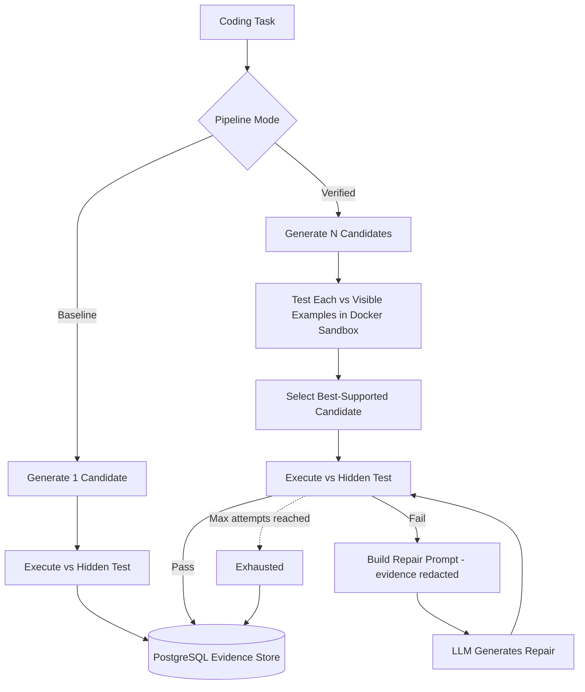
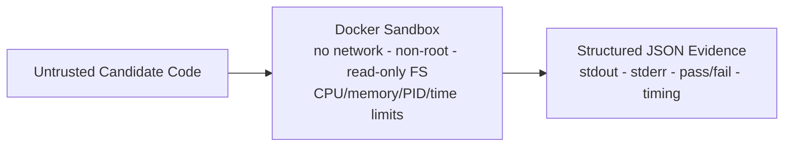

# Project Handoff — Experimental Self-Verifying AI

**MCA (AI & DS) Major Project, K.R. Mangalam University — Solo project**

This document briefs whoever picks up this codebase next — a new developer, a new
AI coding assistant, or a new Claude conversation — on what the project is, what
is actually built (verified against the code, not against memory of how it was
built), what's left to do, and how to work on it safely.

> **How this document was produced:** every claim about the current codebase below
> was checked by reading the actual source files in this repository at the commit
> it was written against, not recalled from a prior conversation. Where something
> is a historical decision or a planned next step rather than present code, it is
> labeled as such.

---

## Table of Contents

1. [What This Project Is](#1-what-this-project-is)
2. [Research Gap vs. What's Implemented — Honest Comparison](#2-research-gap-vs-whats-implemented--honest-comparison)
3. [Architecture](#3-architecture)
4. [Module-by-Module Walkthrough](#4-module-by-module-walkthrough)
5. [Data Flow — Exactly What Happens on a Request](#5-data-flow--exactly-what-happens-on-a-request)
6. [Database Schema](#6-database-schema)
7. [Sandbox Security Model](#7-sandbox-security-model)
8. [LLM Integration](#8-llm-integration)
9. [Frontend](#9-frontend)
10. [API Reference](#10-api-reference)
11. [Evaluation Methodology & Results](#11-evaluation-methodology--results)
12. [Testing](#12-testing)
13. [Known Bugs Found & Fixed (Development History)](#13-known-bugs-found--fixed-development-history)
14. [Limitations Register](#14-limitations-register)
15. [Security Guarantees — What's Proven vs. Assumed](#15-security-guarantees--whats-proven-vs-assumed)
16. [Windows Setup Guide](#16-windows-setup-guide)
17. [Working on This Repo — Operating Rules](#17-working-on-this-repo--operating-rules)
18. [Prioritized Roadmap](#18-prioritized-roadmap)
19. [Context for the Next AI Session — First-Session Checklist](#19-context-for-the-next-ai-session--first-session-checklist)
20. [Current Project Status Snapshot](#20-current-project-status-snapshot)

---

## 1. What This Project Is

**Claim:** Most AI agents go straight from "the model generated an answer" to "the
answer is executed" — there is no checkpoint in between. Prior reliability
techniques (ReAct, Self-Refine, Reflexion, Chain-of-Verification) all improve an
answer through the model re-examining its own text — reasoning about it again,
critiquing it, asking itself questions — without ever actually *running* the
candidate and observing what happens.

**This project's contribution:** replace *textual* self-correction with
*experimental* self-correction. Generate several candidate solutions, execute
each one in an isolated sandbox, and use the observed pass/fail evidence — not
the model's own confidence — to decide what gets trusted. If the selected
candidate still fails against a stronger check, feed the failure evidence back
to the model for a bounded number of repair attempts before giving up.

**Implementation domain (verified):** code generation, using the
[HumanEval benchmark](https://github.com/openai/human-eval) (MIT licensed) as
the concrete task set, plus a free-form "ask any coding question" mode that
generalizes the same pipeline beyond fixed benchmark tasks.

**Two loops, concretely:**
- **Pre-execution loop:** generate *N* candidates → run each against a weaker,
  cheap check ("visible" tests) in the sandbox → select the candidate with the
  best observed score.
- **Post-execution loop:** run the selected candidate against a stronger,
  authoritative check ("hidden" tests) → on failure, build a repair prompt from
  redacted failure evidence → regenerate → retry, up to a configured cap.

---

## 2. Research Gap vs. What's Implemented — Honest Comparison

| Area | Original research framing | What is actually implemented (verified in code) |
|---|---|---|
| Verification philosophy | Execute-before-trust, not text-only self-critique | **Implemented as designed.** `verified_pipeline.py` and `interactive_pipeline.py` never trust a candidate without running it in `SandboxExecutor` first. |
| Candidate diagnosis on failure | "Competing hypotheses" — multiple theories of *why* something failed, each tested | **Simplified.** `_repair_evidence_summary()` produces one redacted evidence string (failure count, exception type names, timeout/process status) and one repair prompt per retry — a single feedback-and-retry loop, not multi-hypothesis generation. This was a deliberate time-scoping decision made mid-project, documented in the README's Limitations section. |
| Candidate selection | Confidence-weighted scoring | **Simplified.** `select_best_candidate()` in `verified_pipeline.py` picks by raw visible-test pass count (`max` over `visible_score`), with ties broken by generation order (first-generated wins — a property of Python's `max`, not a written tie-break rule). No confidence weighting is computed anywhere. |
| Domain generalization | Not domain-specific in the synopsis | **Narrower than framed.** Only code generation is implemented. The interactive pipeline (`interactive_pipeline.py`) generalizes *within* code generation (free-form questions vs. fixed HumanEval tasks) but does not touch a second decision domain (e.g., planning, tool-use agents). |
| Evidence store | "Evidence store" concept | **Implemented.** Every candidate and repair attempt is persisted to PostgreSQL via the `attempts` table (`app/models.py`), with `stdout`, `stderr`, `error_summary`, pass/fail flags, token usage, and duration — a full audit trail per session. |
| Failure recovery / replanning | Central research claim | **Implemented but never exercised by real evaluation data.** The repair loop exists, is unit-tested with synthetic failures, and its prompt-safety property was verified with a live deliberately-triggered repair — but in the actual 150-run evaluation, every selected candidate passed its hidden test on the first attempt, so repair never fired "in the wild." This is the single most important caveat for anyone writing up results — see [§11](#11-evaluation-methodology--results) and [§14](#14-limitations-register). |

**Bottom line for whoever picks this up:** the *mechanism* (generate → verify
experimentally → select by evidence → repair on failure) is real, implemented,
and tested. The *sophistication* of selection (confidence-weighting) and
diagnosis (competing hypotheses) was scoped down for time. State this plainly in
any paper or defense — it is a legitimate, deliberate scope decision, not a
hidden gap.

---

## 3. Architecture





**Three pipelines, one shared sandbox primitive:**

| Pipeline | File | Candidates | Verification | Repair |
|---|---|---|---|---|
| Baseline | `app/pipeline.py` | 1 | None — direct execution against the hidden test | None |
| Verified (HumanEval) | `app/verified_pipeline.py` | `settings.verification_candidates` (default 3) | Visible-test pre-check, then hidden-test execution | Bounded, `settings.max_repair_attempts` (default 2) |
| Interactive (free-form) | `app/interactive_pipeline.py` | same setting | Either user-supplied tests or pooled self-generated consistency tests, then a second run of the same oracle as the "hidden" check | Same bound, reuses `verified_pipeline`'s repair-evidence redaction |

`interactive_pipeline.py` explicitly reuses `_repair_evidence_summary`,
`select_best_candidate`, and `VerifiedPipeline._attempt_from_evidence` from
`verified_pipeline.py` rather than duplicating the logic — this is intentional
and should be preserved if either pipeline is modified.

---

## 4. Module-by-Module Walkthrough

### `app/main.py` (671 lines)
FastAPI app. Three JSON API routes (`/baseline/run`, `/verified/run`,
`/interactive/run`), one GET data route (`/tasks/humaneval`), and three HTML page
routes (`/`, `/interactive`, `/humaneval`) that return **server-rendered HTML with
inline CSS and vanilla JS**, built as Python f-strings/triple-quoted strings —
there is no templating engine, no frontend build step, no separate static asset
pipeline. `SHARED_STYLES` (a large `<style>` block) and `page_shell()` (the common
header/nav/theme-toggle wrapper) are shared across all three pages. Each page's
JS lives inline in its own route function as a `<script>` string. Error payloads
from pydantic validation are FastAPI's default 422 array-of-objects shape; the
frontend JS explicitly reduces that to a readable string (`errorMessage()`).

### `app/config.py`
A pydantic-settings `Settings` class reading from `.env` (see `.env.example` for
the authoritative list of variables). Current defaults verified in code:
`database_url="postgresql+psycopg://postgres@localhost:5432/sva"`,
`llm_model="gpt-4.1-mini"` (overridden to `openai/gpt-oss-120b` in `.env.example`
for the Groq setup actually used), `verification_candidates=3`,
`max_repair_attempts=2`, `sandbox_image="sva-sandbox:latest"`.

### `app/llm.py`
`LLMClient` is an ABC with one method, `generate(prompt) -> Generation`.
`OpenAIClient` is the only implementation: wraps the official `openai` Python SDK,
calls `client.responses.create(model=..., input=prompt)`, and optionally takes
`base_url` so any OpenAI-compatible provider works — this is how the project
runs against Groq's free tier instead of paid OpenAI. Raises `RuntimeError` at
call time (not construction time) if `LLM_API_KEY` is unset.

### `app/dataset.py`
`HumanEvalLoader` downloads `HumanEval.jsonl.gz` from the upstream OpenAI GitHub
repo on first use, decompresses it, and caches it at `settings.humaneval_cache_path`
(default `.cache/humaneval.jsonl`, gitignored). Loader is capped to the first 25
tasks (`limit: int = 25` default) — **this is why "25 cached tasks" appears
throughout the evaluation results; it is a loader default, not a dataset
limitation.** `_visible()` extracts `>>>` doctest-style lines from the prompt as
descriptive visible examples (the actual executable assertions are derived
separately — see next).

### `app/code_extraction.py`
`extract_python_code()` strips Markdown code fences from LLM completions, falling
back to scanning for the first line that looks like Python (`def`, `class`,
`import`, decorator, comment) and then trimming any trailing non-compiling prose
by binary-searching for the longest syntactically valid prefix. This exists
because of a real early bug — see [§13](#13-known-bugs-found--fixed-development-history).

### `app/sandbox.py`
`SandboxExecutor.run(candidate_code, tests)` writes the candidate to a temp file,
base64-encodes the test list into an env var (`SVA_TESTS_B64`), and runs
`docker/runner.py` inside a hardened container (see [§7](#7-sandbox-security-model)).
Parses the container's last stdout line as JSON (`{"results": [...]}`). **A
candidate is only `passed=True` if there is at least one test result, every test
passed, and the container's exit code was 0** — an empty/garbled test-evidence
list is explicitly treated as failure, not an accidental pass (this was a
deliberate hardening fix, not original behavior — see §13).

### `app/pipeline.py` — Baseline
One `LLMClient.generate()` call, one `extract_python_code()`, one
`SandboxExecutor.run()` against only the hidden test, persisted as a `Run` row.
No verification step at all — this is the "what if we just trusted the model"
comparison point.

### `app/verified_pipeline.py` — Verified (HumanEval)
See [§5](#5-data-flow--exactly-what-happens-on-a-request) for the full
candidate → select → repair sequence. Key functions:
- `visible_assertions(task)` — turns HumanEval's docstring `>>>` examples into
  real `assert` statements using `doctest.DocTestParser` + `ast.literal_eval`
  (falling back to `repr()` comparison for non-literal expected values).
- `select_best_candidate(evidences)` — `max()` by visible-test pass count.
- `_repair_evidence_summary(evidence)` — **the security-critical function**; see
  [§7](#7-sandbox-security-model).
- `_attempt_from_evidence()` — shared helper (also used by the interactive
  pipeline) that copies sandbox results onto an `Attempt` ORM row.

### `app/interactive_pipeline.py` — Interactive (free-form)
Generalizes the verified pipeline to arbitrary user questions instead of fixed
HumanEval tasks. Key differences from the verified pipeline:
- **Dual oracle modes.** If the caller supplies `tests`, those are used verbatim
  as the oracle and the session is labeled `oracle_kind="user_supplied"`. If not,
  the pipeline asks the LLM to propose test assertions *for each candidate*
  (`_test_prompt`), pools the distinct `assert ...` lines across all candidates
  (`pooled_assertions`), and labels the session `oracle_kind="self_generated"` —
  this is explicitly weaker evidence (consistency across candidates, not an
  independent ground truth) and the frontend must always say so.
- **Canonical function-name enforcement.** `top_level_function_name()` AST-parses
  the first candidate to find its function name, then every subsequent
  candidate-generation and test-generation prompt is told to use that exact name.
  This exists to fix a real bug (independently-generated candidates picking
  different function names caused spurious `NameError`s when pooled
  self-generated tests ran against the "wrong" candidate — see §13).
- Reuses `VerifiedPipeline._attempt_from_evidence`, `select_best_candidate`, and
  `_repair_evidence_summary` directly.

### `app/models.py`
SQLAlchemy 2.0 declarative models. Four tables: `runs` + `test_results` (baseline
pipeline only), `verification_sessions` + `attempts` (verified and interactive
pipelines, sharing the same tables — `VerificationSession.source` is the string
discriminator, `"humaneval"` vs `"interactive"`). `Attempt.phase` is an enum
(`candidate` | `repair`); `attempt_index` numbers attempts within their phase,
0-indexed in storage (the frontend displays `attempt_index + 1` to users).

### `app/database.py`
A single SQLAlchemy `engine`/`sessionmaker` pair built from `settings.database_url`.
No connection pooling customization beyond SQLAlchemy defaults.

### `docker/sandbox.Dockerfile` + `docker/runner.py`
Minimal `python:3.11-alpine` image, non-root `sandbox` user, single entrypoint
`runner.py`. The runner `exec()`s the candidate module once, then `exec()`s each
test string against that module's namespace, capturing stdout/stderr per test and
catching `BaseException` (not just `Exception`) so even a candidate that calls
`sys.exit()` or raises `SystemExit`/`KeyboardInterrupt` is reported as a failed
test rather than crashing the runner silently.

### `alembic/` — 4 migrations
`0001_baseline.py` (runs/test_results) → `0002_verification_sessions.py`
(verification_sessions/attempts) → `0003_trial_index.py` (adds `trial_index` to
both run tables for the evaluation harness) → `0004_interactive_sessions.py`
(adds `source`, `question`, `oracle_kind`, `oracle_tests` to
`verification_sessions`). `alembic/env.py` overrides `sqlalchemy.url` from
`settings.database_url` at runtime, so the `alembic.ini` fallback value is
cosmetic/dev-default only.

### `scripts/`
- `run_evaluation.py` — resumable batch runner across the full task set with
  provider rate-limit pacing/retry (written against Groq's free-tier limits: 30
  requests/minute, 1000/day).
- `compute_metrics.py` — reads `runs` and `verification_sessions`/`attempts` from
  Postgres, computes aggregate and per-task CSVs. Explicitly documents in its own
  docstring that "Failure Diagnosis Accuracy" and "Evidence Quality" metrics are
  **out of scope** because the single-repair-prompt design doesn't store
  independent diagnosis labels — don't try to report those without adding new
  instrumentation first.
- `validate_baseline.py` — small smoke-test runner.
- `diagnose_visible_tests.py` — diagnostic utility for visible-test extraction
  coverage across the cached task set.

---

## 5. Data Flow — Exactly What Happens on a Request

### `POST /verified/run {"task_id": "HumanEval/0"}`

1. `VerifiedPipeline.run()` loads the `Problem` via `HumanEvalLoader`, derives
   `visible_assertions(task)`. If there are zero executable visible assertions
   for this task, the whole run raises `RuntimeError` (caller gets HTTP 503).
2. Opens a DB session, inserts a `VerificationSession(status=running)`, flushes
   to get an id.
3. Loop `verification_candidates` times (default 3): call the LLM with
   `_generation_prompt(task)`, extract code, run it against the **visible**
   assertions in the sandbox, store an `Attempt(phase=candidate)` row with
   `passed_visible_tests` set.
4. `select_best_candidate()` picks the candidate with the highest visible-test
   pass count (ties → earliest generated). Marks it `is_selected=True`.
5. Runs the **selected** candidate against the **hidden** test (the real,
   authoritative canonical test). Sets `passed_hidden_tests` on that same
   `Attempt` row (visible and hidden results live on the same row for the
   selected candidate).
6. If hidden passed → `session.status = succeeded`, done.
7. If hidden failed → repair loop, up to `max_repair_attempts` times: build
   `_repair_prompt(task, failed_code, evidence)` using the **redacted** evidence
   summary (never raw stdout/stderr/test source), call the LLM, extract, re-run
   against the hidden test, store a new `Attempt(phase=repair)` row. First repair
   that passes sets `status = succeeded` and breaks. If the loop exhausts without
   success, `status = exhausted`.
8. Commits, refreshes, and returns the full `VerificationSession` with its
   ordered `attempts` relationship loaded.
9. `main.py`'s `verified_run()` serializes this into the JSON response shape
   shown in [§10](#10-api-reference).

### `POST /interactive/run`

Same shape, with three differences: (a) the first candidate's function name is
extracted and enforced on all later candidates/tests; (b) the oracle is either
the caller's `tests` or pooled self-generated assertions, not a fixed hidden
test; (c) the "hidden" check in step 5 above is literally the same oracle run a
second time against the selected candidate (there is no separate stronger test
for interactive mode — the user-supplied tests *are* the strongest evidence
available, and self-generated ones are honestly labeled as weaker).

---

## 6. Database Schema

```
runs                          verification_sessions
├─ id PK                      ├─ id PK
├─ task_id                    ├─ task_id
├─ mode (baseline|verified)   ├─ source ("humaneval"|"interactive")
├─ trial_index                ├─ question (nullable)
├─ candidate_code             ├─ oracle_kind (nullable: user_supplied|self_generated)
├─ hidden_passed              ├─ oracle_tests (JSON, nullable)
├─ duration_ms                ├─ trial_index
├─ token_usage                ├─ status (running|succeeded|exhausted)
└─ created_at                 ├─ created_at / completed_at
                               └─ attempts (1:N, cascade delete)
test_results (1:N of runs)
├─ id PK, run_id FK            attempts
├─ name, passed                ├─ id PK, session_id FK
├─ stdout, stderr, error       ├─ phase (candidate|repair)
                               ├─ attempt_index (0-indexed within phase)
                               ├─ candidate_code
                               ├─ passed_visible_tests (nullable bool)
                               ├─ passed_hidden_tests (nullable bool)
                               ├─ is_selected
                               ├─ stdout, stderr, error_summary
                               ├─ token_usage, duration_ms
                               └─ created_at
```

Two parallel schemas exist because the baseline pipeline predates the verified
pipeline's more detailed attempt-tracking design and was never migrated onto it
— this is intentional, not an oversight: baseline only ever has one candidate,
so it doesn't need the richer `attempts` table.

---

## 7. Sandbox Security Model

Every candidate — baseline, verified, interactive, repair — runs through the
same `SandboxExecutor.run()`, which launches a container with:

- `network_disabled=True` — no network access at all.
- `read_only=True` filesystem, with a `tmpfs` mount at `/tmp` that is itself
  `noexec,nosuid` and capped at 16 MB.
- `user="sandbox"` — non-root, defined in the Dockerfile.
- `cap_drop=["ALL"]` and `security_opt=["no-new-privileges:true"]`.
- `pids_limit=64`, `mem_limit="128m"`, `nano_cpus=500_000_000` (0.5 CPU).
- A wall-clock timeout (`timeout_seconds`, default 5s) enforced by `output.wait(timeout=...)`;
  on timeout the container is force-killed and the evidence explicitly marks
  `timed_out=True` rather than silently returning no result.

**Independently tested** (see `tests/test_sandbox.py`): an infinite-loop
candidate is killed by the timeout, not left running; a candidate that attempts
to spawn a subprocess does not escape the container or hang the sandbox; a
candidate producing zero test evidence (e.g. a crash before any test ran) is
reported as failed, not silently passed.

**The repair-prompt integrity guarantee** (the most research-relevant security
property): when a candidate fails, the system must tell the LLM *something* about
why, to make repair possible — but the raw failure evidence (stdout, stderr,
Python tracebacks) can and does contain literal source lines from hidden tests
or user-supplied oracle assertions (Python's default traceback printer includes
the failing `assert` statement's source). If that leaked back into the repair
prompt, the model could effectively read the "hidden" answer key it's supposed
to be tested against — undermining the entire evaluation's validity.

`_repair_evidence_summary()` in `verified_pipeline.py` is the fix: it is an
**explicit allow-list**, not a redaction/blocklist. It only ever emits:
1. A count ("`2 of 3 tests failed`").
2. Built-in exception *type names* detected in the error text (matched against
   `vars(builtins)` — so "ZeroDivisionError" is allowed through but the message
   text around it, which might quote an expected value, is not).
3. Whether the sandbox process itself exited non-zero, or timed out.

It **never** touches `evidence.stdout`, `evidence.stderr`, or per-test `error`
message bodies beyond that regex-style type-name scan. This was verified not
just by reading the code but by capturing real repair-prompt text from a live,
deliberately-triggered repair run and confirming no test source appeared in it.

**If you modify the repair prompt or add new evidence fields, this allow-list
discipline must be preserved** — it is the single most important invariant in
the codebase for research integrity. Grep for `_repair_evidence_summary` and
`_BUILTIN_EXCEPTION_NAMES` before changing anything nearby.

---

## 8. LLM Integration

- Client: official `openai` Python SDK, used generically via `base_url` override
  — **not** OpenAI-specific despite the class name `OpenAIClient`.
- Actual provider in use per `.env.example`: **Groq**, free tier, model
  `openai/gpt-oss-120b`, `base_url=https://api.groq.com/openai/v1`. This switch
  happened mid-project after hitting OpenAI billing constraints.
- Rate limits that shaped `scripts/run_evaluation.py`'s pacing: Groq free tier —
  30 requests/minute, 1000 requests/day.
- `Generation.token_usage` reads `response.usage.total_tokens` defensively via
  `getattr(..., None)` — not every provider/response shape guarantees this
  field.
- **API keys are never logged, stored in the database, or committed.** They are
  read from environment variables only (`LLM_API_KEY`). If you are picking up
  this project and see an API key pasted anywhere in chat history, treat it as
  already exposed and rotate it — this happened twice during development and
  both keys should be treated as compromised if not already rotated.

---

## 9. Frontend

No framework, no build step, no bundler. Three pages, each a Python
triple-quoted string in `app/main.py`, sharing `SHARED_STYLES` and `page_shell()`.

- **Theme:** CSS custom properties switched via a `data-theme` (or similar)
  attribute, defaulting to `prefers-color-scheme`, persisted to `localStorage`
  (`THEME_SCRIPT`, injected into every page by `page_shell()`).
- **Nav:** shared header across all three pages (`/`, `/interactive`, `/humaneval`)
  with `aria-current="page"` on the active link.
- **Interactive page JS** (`/interactive`): disables the run button during a
  request, shows a 3-card skeleton-loading state (`skeletonCards()`), computes
  scores for *every* attempt (not just the selected one) via `evidenceFor()` +
  `scores`/`answerScore` so the "best attempt" shown really is the
  highest-scoring one across candidates and repairs — this was a fixed bug, see
  §13 — renders a plain-English "why this candidate was selected" explanation,
  and has a working copy-to-clipboard button on the final answer.
- **HumanEval demo page JS** (`/humaneval`): loads the task list from
  `/tasks/humaneval` (never hardcoded), runs baseline or verified on the selected
  task, shows per-candidate visible/hidden pass status.
- **No remaining legacy code.** An earlier `querySelector`/`getElementById`
  "compatibility" layer (`idAliases`, global `window.q/c/t/go/r` aliases that
  monkey-patched `Document.prototype`) was identified as unnecessary and risky
  (global prototype overrides affecting unrelated pages) and was removed. The
  current `main.py` was re-checked during this handoff and confirms clean
  `document.querySelector(...)` calls throughout with no aliasing layer present.
- **Error handling:** every fetch call is wrapped in try/catch, buttons are
  disabled during requests and re-enabled in a `finally` block, and FastAPI's
  422 validation error array is reduced to a readable string via `errorMessage()`
  instead of rendering `[object Object]`.

If a next developer wants a real frontend (React/Vue, component structure,
tests, etc.), this is the biggest honest rewrite candidate in the project — the
current approach was a deliberate "ship fast, no build step" choice for a solo
academic project, not a long-term architecture recommendation.

---

## 10. API Reference

All routes are defined in `app/main.py`. Swagger UI is available at `/docs` when
the app is running.

| Method | Path | Request body | Notes |
|---|---|---|---|
| `GET` | `/` | — | Home/landing page (HTML) |
| `GET` | `/interactive` | — | Interactive Verification Studio (HTML) |
| `GET` | `/humaneval` | — | HumanEval Benchmark Demo (HTML) |
| `GET` | `/tasks/humaneval` | — | Returns `list[str]` of cached task ids, read live from `HumanEvalLoader`, never hardcoded |
| `POST` | `/baseline/run` | `{"task_id": "HumanEval/0"}` | 404 on unknown task id, 503 if the LLM key is missing/the client raises `RuntimeError` |
| `POST` | `/verified/run` | `{"task_id": "HumanEval/0"}` | Same error handling as baseline, plus `ValueError` → 503 (e.g. zero visible assertions for a task) |
| `POST` | `/interactive/run` | `{"question": str, "code": str\|null, "tests": list[str]\|null}` | `question` must be non-empty (pydantic `Field(min_length=1)`); if `tests` is provided it must be a non-empty list of non-empty strings or the pipeline raises `ValueError` → 503 |

**`/verified/run` response shape:**
```json
{
  "session": {"id": 1, "task_id": "HumanEval/0", "status": "succeeded",
              "created_at": "...", "completed_at": "..."},
  "attempts": [
    {"id": 1, "phase": "candidate", "attempt_index": 0, "candidate_code": "...",
     "passed_visible_tests": true, "passed_hidden_tests": true, "is_selected": true,
     "stdout": "...", "stderr": "", "error_summary": null,
     "token_usage": 412, "duration_ms": 620.1, "created_at": "..."}
  ]
}
```

**`/interactive/run` response shape** additionally includes
`session.oracle_kind`, `session.oracle_tests`, `session.canonical_function_name`,
`session.canonical_name_note`, and top-level `candidate_test_results`,
`selected_test_results`, `repair_test_results` arrays — these are per-attempt
lists of `{"name", "passed", "error"}` objects, used by the frontend to compute
per-candidate scores. **If you touch this response shape, update the frontend's
`evidenceFor()`/`scores` logic in the `/interactive` page script in the same
change — they are tightly coupled by index position.**

---

## 11. Evaluation Methodology & Results

**Setup (per README, cross-checked against `scripts/run_evaluation.py` and
`scripts/compute_metrics.py` logic):** 25 cached HumanEval tasks × 3 independent
trials × 2 pipelines (baseline, verified) = 150 total runs, 225 generated
candidates in the verified arm (3 candidates × 75 verified sessions).

> **Note on reproducing these numbers:** `evaluation_results/` is gitignored and
> was not present in the cloned repository at handoff time. The figures below
> are the last reported results from the development conversation and should be
> **re-generated and re-verified** (`python scripts/run_evaluation.py` then
> `python scripts/compute_metrics.py`) before being cited in a final paper or
> defense, rather than trusted from memory.

| Metric | Baseline | Verified |
|---|---|---|
| Task success rate | 92% (69/75) | **100% (75/75)** |
| Verification accuracy (visible-test predicting hidden-test outcome) | — | 99.56% |
| False positive rate (visible passed, hidden failed) | — | 0.51% |
| False negative rate (visible failed, hidden would have passed) | — | 0% |
| Avg. tokens / trial | 476 | 1,444 (~3.0×) |
| Avg. duration / trial | 617 ms | 1,753 ms (~2.8×) |
| Repair loop triggered | — | 0 times across all 75 sessions |

**Metric formula notes (from `scripts/compute_metrics.py`, already fixed once
during development — see §13):**
- False positive rate = `FP / (TP + FP)` — of candidates approved by the visible
  check, what fraction failed the hidden check. (The earlier, wrong formula was
  `FP / (FP + TN)`.)
- "Failure Diagnosis Accuracy" and "Evidence Quality" are explicitly **not**
  computed — the script's own docstring says reporting a proxy for these would
  be misleading given the single-repair-prompt design.
- `eval_sessions` filtering requires every candidate in a session to have a
  recorded hidden-test result — this is why `eval_hidden_candidates=True` exists
  as an instrumentation-only flag on `VerifiedPipeline.run()` (it runs hidden
  tests against the non-selected candidates too, purely for measurement, and is
  explicitly documented as never influencing selection, repair, or the real
  pipeline's LLM call count).

**The headline honest caveat:** the repair/recovery loop is implemented,
independently unit-tested (synthetic failing candidates), and its prompt-safety
property was verified live — but it was **never exercised by real evaluation
data**, because every selected candidate happened to pass its hidden test on the
first attempt across all 75 verified sessions. Any write-up must state this
plainly rather than imply the recovery mechanism was empirically validated at
scale. This does not invalidate the reported 92%→100% success-rate improvement,
which comes entirely from candidate generation + selection, not repair.

---

## 12. Testing

```
tests/
├── test_compute_metrics.py
├── test_dataset.py
├── test_interactive_live.py      # marked integration — needs Docker + Postgres + LLM key
├── test_interactive_pipeline.py
├── test_pipeline.py
├── test_sandbox.py               # includes hostile-candidate security tests
└── test_verified_live.py         # marked integration — needs Docker + Postgres + LLM key
└── test_verified_pipeline.py
```

```powershell
python -m pytest -m "not integration"   # fast, no external dependencies
python -m pytest                        # full suite — requires Docker daemon + sva-sandbox image + PostgreSQL + LLM key
```

Reported last full-suite result: 27 tests passing, including sandbox security
tests (`test_infinite_loop_is_killed`, `test_subprocess_attempt_does_not_escape_or_hang`,
`test_zero_test_evidence_is_not_reported_as_passed`, `test_good_and_bad_candidates`)
and live endpoint smoke tests hitting real `/verified/run` and `/interactive/run`.
**Re-run the full suite after any change before claiming it works** — this
project's development process treated "tests pass" claims from an AI coding
agent as unverified until independently re-run or the actual test output was
inspected line-by-line; keep that discipline.

---

## 13. Known Bugs Found & Fixed (Development History)

This is a reference list for anyone wondering "has this already been tried/fixed"
— all of these were found and fixed during development, not open issues.

1. **Unstripped LLM markdown fences reaching the sandbox** → silent 100% hidden-test
   failure in early baseline validation. Fixed by `app/code_extraction.py`.
2. **Alembic using a hardcoded wrong DB name** in `alembic.ini`, silently
   overriding `.env` — fixed by having `alembic/env.py` set
   `sqlalchemy.url` from `settings.database_url` at runtime.
3. **Stale OS-level environment variables** in already-open terminals overriding
   `.env` values (happened for both `DATABASE_URL` and `LLM_API_KEY`) — not a
   code bug, but a recurring environment gotcha; always open a fresh terminal
   after changing `.env`.
4. **Flat-layout package discovery failure** on `pip install -e ".[dev]"` — fixed
   by `[tool.setuptools.packages.find] include = ["app*"]` in `pyproject.toml`.
5. **SQLite-vs-Postgres validation gap**: a migration was once validated against
   a temporary SQLite fallback (Postgres unreachable in that environment) and
   reported as "done." This was rejected as insufficient evidence; re-validated
   against the real Postgres backend via `alembic upgrade head` + a direct SQL
   query. **Lesson: always demand validation against the real configured
   backend, not a convenient stand-in.**
6. **Repair-prompt hidden-test-leakage risk** — see §7. Fixed via the
   `_repair_evidence_summary` allow-list; verified it had zero effect on the
   already-reported evaluation results since repair never fired in real data.
7. **False-positive-rate metric formula bug** — `FP/(FP+TN)` → corrected to
   `FP/(TP+FP)` in `scripts/compute_metrics.py`.
8. **Interactive-pipeline cross-candidate NameErrors** — independently generated
   candidates picked different function names, so pooled self-generated tests
   spuriously failed candidates that didn't define the name a given test
   expected. Fixed via `top_level_function_name()` AST extraction + canonical
   name enforcement in generation/test prompts.
9. **"Best attempt" UI section, bug 1**: always read
   `data.candidate_test_results[...]` regardless of attempt phase, so a
   repair-phase selection indexed into the wrong evidence array. Fixed with a
   phase-aware lookup (`evidenceFor()`).
10. **"Best attempt" UI section, bug 2**: assumed "most recent repair = best"
    rather than actually scoring every attempt. Fixed by scoring all attempts
    (candidates + repairs) and picking the genuine highest scorer.
11. **`[object Object]` error rendering**: FastAPI 422 errors are an array of
    objects; naive `data.detail` rendering showed the literal string. Fixed with
    `errorMessage()`.
12. **Misleading success banner**: banner color/label was driven by which oracle
    mode was used, not by whether a solution actually passed. Fixed by
    decoupling the outcome banner from the oracle-mode label.
13. **Double-submit / no network-error handling** on the interactive page — fixed
    by disabling the run button for the duration of the request and wrapping
    `fetch` in try/catch.
14. **Legacy `querySelector` compatibility shim removed** — a `Document.prototype`
    monkey-patch layer (`idAliases`, global `window.q/c/t/go/r`) was identified as
    unused dead code and a cross-page risk, and was removed; confirmed absent on
    re-inspection during this handoff.

---

## 14. Limitations Register

- Single domain evaluated (code generation via HumanEval-style tasks) — no
  evidence of generalization to other agentic decision domains.
- Selection uses raw visible-test pass count, not confidence-weighted scoring.
- Repair is a single feedback-and-retry step, not competing-hypothesis diagnosis,
  and was never exercised by real evaluation failures.
- Evaluation sample (25 tasks × 3 trials) is modest; no formal statistical
  significance testing (e.g. confidence intervals, pass@k treatment) has been
  applied to the reported numbers.
- Results reflect a single underlying model (`openai/gpt-oss-120b` via Groq) —
  no cross-model/cross-provider generalization testing.
- HumanEval's 25-task cap is a loader default (`HumanEvalLoader(limit=25)`), not
  a hard constraint — raising it would let a next session evaluate the full
  164-task set with the same code, at the cost of more LLM calls against a free
  rate-limited tier.
- Frontend has no automated test coverage of its own (the `/interactive` and
  `/humaneval` pages' JS is only covered by manual/browser-agent QA described in
  development history, not by, e.g., Playwright tests committed to the repo).
- `evaluation_results/` is gitignored — numeric results currently live only in
  conversation history / external exports, not in the repository itself. A next
  session should re-run the evaluation and decide whether to commit a results
  snapshot (e.g. under `docs/` instead of the gitignored working directory).

---

## 15. Security Guarantees — What's Proven vs. Assumed

**Proven (tested):**
- Sandbox network isolation, read-only FS, non-root user, dropped capabilities,
  resource limits (§7).
- Hostile-candidate containment: infinite loops killed by timeout; subprocess
  spawn attempts don't escape or hang the sandbox; zero-test-evidence is treated
  as failure, not an accidental pass.
- Repair-prompt evidence allow-list excludes raw stdout/stderr/test source,
  verified against real captured prompt text from a live triggered repair.
- API keys never logged, stored in DB, or committed; read from env vars only.

**Assumed, not independently audited:**
- Docker daemon itself is trusted infrastructure (container escape via a Docker
  engine vulnerability is out of scope for this project's threat model).
- The `python:3.11-alpine` base image's own supply chain (no SBOM/vulnerability
  scan performed as part of this project).
- No rate limiting / abuse protection on the FastAPI endpoints themselves (this
  is a research prototype, not a hardened public service) — do not deploy this
  publicly without adding auth and rate limiting.
- LLM provider trust: prompts (including the user's free-form question and code)
  are sent to a third-party API (Groq or OpenAI) as plaintext; no data
  minimization or PII handling has been implemented for the interactive mode.

---

## 16. Windows Setup Guide

(Verified against `.env.example`, `pyproject.toml`, `docker/`, `alembic.ini` as
they exist in the repo today.)

```powershell
# 0. Prerequisites: Docker Desktop (running), Python 3.11+, git

# 1. Clone and enter the repo
git clone https://github.com/Harsh0012-ux/Self-Verifying-AI.git
cd Self-Verifying-AI

# 2. Create and activate a virtual environment
python -m venv .venv
.venv\Scripts\activate

# 3. Install the project (editable) with dev dependencies
pip install -e ".[dev]"

# 4. Start PostgreSQL (name/db must match your DATABASE_URL)
docker run --name sva-postgres -e POSTGRES_PASSWORD=<password> -e POSTGRES_DB=sva -p 5432:5432 -d postgres:16

# 5. Build the sandbox image (name must match SANDBOX_IMAGE / app/config.py default)
docker build -t sva-sandbox:latest -f docker/sandbox.Dockerfile .

# 6. Configure environment
copy .env.example .env
# edit .env: set LLM_API_KEY (Groq or OpenAI-compatible key), confirm DATABASE_URL
# matches step 4's container, LLM_MODEL/LLM_BASE_URL per your provider

# 7. Apply database migrations
alembic upgrade head

# 8. Run the app
uvicorn app.main:app --reload
```

Visit `http://127.0.0.1:8000/` for the home page, `http://127.0.0.1:8000/docs`
for Swagger UI.

**Common gotchas (all hit during development — see §13):**
- If `alembic upgrade head` or the app connects to the wrong database, check for
  a **stale `DATABASE_URL`/`LLM_API_KEY` environment variable set at the OS
  level in an already-open terminal** before assuming the code is broken — open
  a fresh terminal and retest.
- `pip install -e ".[dev]"` failing with a flat-layout package-discovery error
  means `pyproject.toml`'s `[tool.setuptools.packages.find]` config was reverted
  or is missing — it must include `app*`.
- If `/baseline/run` or `/verified/run` return 503 with a sandbox-image-missing
  message, you skipped or need to re-run step 5.
- Never commit `.env` — it's gitignored; always edit the real `.env`, never
  `.env.example`, with live keys.

---

## 17. Working on This Repo — Operating Rules

These are the working norms established over the project's development and
should carry forward:

1. **Trust but verify, always.** A claim that "tests pass" or "the feature
   works" is not evidence. Demand (or produce) real named test output, real
   live-run responses, or real source-code excerpts before treating something
   as done. This project caught several real discrepancies this way (§13, items
   5 and 14).
2. **Never store a pasted API key anywhere** — not in memory, not in a file, not
   in a commit. If you see one in conversation history, treat it as exposed and
   tell the user to rotate it.
3. **Preserve the repair-prompt evidence allow-list discipline** (§7) in any
   change that touches failure evidence, repair prompts, or error reporting —
   this is the project's core research-integrity guarantee.
4. **Re-run the full test suite** (`python -m pytest`, requires Docker + Postgres
   + LLM key) after any pipeline or sandbox change, not just the fast subset.
5. **Keep the baseline pipeline unverified on purpose.** It exists specifically
   as the "no verification" comparison point for the evaluation — don't
   accidentally "improve" it by adding verification logic.
6. **Report honest limitations, don't manufacture results.** When the repair
   loop never fired in real evaluation data, the documented decision was to
   write this up honestly rather than construct harder tasks just to force a
   repair to trigger artificially. Keep that standard for any future evaluation
   work.
7. **`evaluation_results/` is gitignored on purpose** (raw CSV output,
   regeneratable) — don't force-add it; if a results snapshot needs to be
   permanent, commit it under `docs/` instead.

---

## 18. Prioritized Roadmap

**Phase A — Re-establish ground truth (do this first)**
- Re-run `python scripts/run_evaluation.py` + `python scripts/compute_metrics.py`
  against the current code and a fresh Groq (or other) API key; confirm the
  headline numbers in §11 still hold, since they currently exist only in
  conversation history, not in the repo.
- Capture fresh screenshots into `docs/screenshots/` if the UI has drifted from
  what's there.

**Phase B — Strengthen the evaluation**
- Raise `HumanEvalLoader`'s `limit` beyond 25 (ideally the full 164-task set),
  budgeting against the LLM provider's rate limits.
- Add pass@k-style statistical treatment / confidence intervals instead of raw
  percentages.
- Design and run a task subset specifically chosen to exercise the repair loop
  with real failures, so the recovery mechanism gets genuine empirical coverage.

**Phase C — Close the research-gap items from §2**
- Replace raw visible-test-pass-count selection with a confidence-weighted
  score.
- Extend `_repair_prompt`/diagnosis from single feedback-and-retry toward
  genuine competing-hypothesis generation and testing.

**Phase D — Generalize beyond code generation**
- Prototype the same generate→verify→select→repair loop in a second decision
  domain (e.g., a simple tool-use/planning task) to support the generalization
  claim.

**Phase E — Frontend maturity**
- Decide whether the no-framework/no-build-step approach stays (fine for a solo
  academic deliverable) or gets rewritten with a real frontend stack and test
  coverage, if this becomes a longer-lived project.

**Phase F — Productionization (only if the project continues past academic
submission)**
- Add authentication/rate limiting before any public deployment.
- Add structured logging/observability beyond what's in the DB.
- Consider CI (GitHub Actions) running `pytest -m "not integration"` on push,
  and a separate manually-triggered job for the Docker/Postgres-dependent
  integration tests.

**Phase G — Deliverables**
- Finalize the research paper and mid-term/final evaluation slides using the
  re-verified numbers from Phase A, with limitations stated per §14.

---

## 19. Context for the Next AI Session — First-Session Checklist

If you are a Claude (or other AI) session picking this project up:

1. **Read this document first**, then skim `README.md` for the public-facing
   framing (they should agree; if they drift apart, this document is more
   detailed but the README is what's shown on GitHub — keep both in sync when
   you change either).
2. **Don't trust memory of "how this was built" over the actual files.** This
   document was itself written by re-reading every core module directly from
   the repository rather than from prior conversation summaries — do the same.
   Open `app/main.py`, `app/verified_pipeline.py`, `app/interactive_pipeline.py`,
   `app/sandbox.py` and `app/models.py` yourself before making claims about
   current behavior.
3. **This is a solo student's major project**, not a team codebase — the person
   you're working with is the sole author/developer, acting as the
   decision-maker; treat them as a capable collaborator who wants a technical
   lead/mentor relationship: explain trade-offs, don't just execute silently,
   and push back on claims (including your own) that lack evidence.
4. **Operating rules in §17 are not optional style preferences** — they reflect
   real mistakes caught during development (stale env vars, unverified test
   claims, a stale QA report reused across rounds, a metric formula bug). Follow
   them.
5. **Before implementing anything**, check §2 (research gap vs. implementation)
   and §14 (limitations) so you don't accidentally claim something is done that
   is actually a known, documented gap.
6. **Ask, don't assume, when the ask is ambiguous** — e.g., whether documentation
   work should be produced directly in the current session vs. prepared as a
   prompt for a separate coding agent (Codex/Copilot/Antigravity) to execute, if
   that workflow is still in use.
7. **If you are coordinating external coding agents** (this project's prior
   workflow used VS Code–based Codex, GitHub Copilot, and Google Antigravity),
   match the tool to the task: Codex for larger multi-file backend changes,
   Copilot for small isolated logic/config fixes, Antigravity (or any
   browser-automation-capable agent) for anything requiring actual visual/UX
   judgment via a render-and-look feedback loop. Demand real evidence back from
   each (named test output, real screenshots with fresh timestamps, real
   response payloads) — not just a completion summary.

---

## 20. Current Project Status Snapshot

*(As verified against the repository at handoff time — 2026-10-20.)*

- **Backend:** complete and tested. Baseline, verified, and interactive
  pipelines all implemented, all sharing the hardened Docker sandbox, all
  persisting full attempt history to PostgreSQL via Alembic-migrated schema (4
  migrations applied).
- **Frontend:** complete three-page app (Home, Interactive, HumanEval Demo)
  with dark mode, shared nav, skeleton loading states, and no known legacy
  dead code remaining.
- **Tests:** 8 test files, last reported 27/27 passing (fast + integration
  combined), including dedicated sandbox-security and repair-prompt-safety
  checks.
- **Evaluation:** methodology implemented and previously run once (150 runs,
  25 tasks × 3 trials × 2 pipelines) with results summarized in §11 — **not
  currently reproducible from the repo alone** since `evaluation_results/` is
  gitignored; re-running it is the top item in the roadmap.
- **Documentation:** `README.md` (public-facing, in repo) and this
  `docs/PROJECT_HANDOFF.md` (internal/technical handoff, written during this
  session) both exist and should be kept consistent going forward.
- **Academic deliverables produced outside the repo** (not committed here):
  a mid-term evaluation PowerPoint built from the university's official
  template, and edits to a research-paper `.docx` — both referenced in prior
  development but not part of this codebase's version control.
- **Outstanding placeholders:** the research paper's author name, roll number,
  email, and supervisor name were left as placeholders during the last editing
  pass because they were not yet known — fill these in before final submission.
- **No open code bugs are currently tracked** beyond the limitations in §14; all
  bugs found during development (§13) were fixed and verified.
